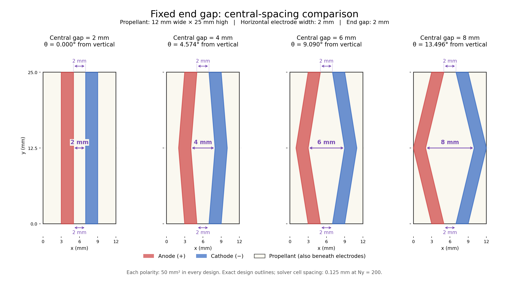

# 끝단 간격을 고정한 중앙 간격 비교: 가로 12 mm·세로 25 mm

`config/electrode_central_gap_study_12x25mm.yaml`은 중앙 전극 간격만
2/4/6/8 mm로 지정하는 독립 parameter study다. 기존 경사각 비교 설정은
그대로 유지하며, 기존 148개 형상 목록이나 staggered 비교를 변경하지 않는다.



## 고정 조건과 형상 정의

- 추진제: 가로 12 mm, 세로 25 mm, 전체 면적 300 mm².
- 양극·음극 각각의 **수평 단면 폭**: 2 mm.
- 위·아래 끝단에서 마주 보는 전극 가장자리 사이: 2 mm.
- 끝단 양극 좌표: x=3~5 mm, 음극 좌표: x=7~9 mm.
- 중앙 높이: y=12.5 mm. 중앙 간격을 넓히면 양극의 중앙은 왼쪽으로,
  음극의 중앙은 오른쪽으로 이동한다. 두 끝 위치는 움직이지 않는다.
- 극당 접촉면적은 모든 조건에서 2×25=50 mm²이며, raster에서도 동일하다.

중앙 간격을 \(g_c\)라고 하면 수평 간격은

\[
g(y)=2+(g_c-2)\left(1-\frac{2|y-12.5|}{25}\right),
\qquad 0\le y\le25
\]

이고, 전극 가장자리는 양극 \([6-g(y)/2-2,\,6-g(y)/2]\),
음극 \([6+g(y)/2,\,6+g(y)/2+2]\)다. 길이 단위는 mm다.
수직 방향 기준 경사각은 독립 입력값이 아니라

\[
\theta=\tan^{-1}\!\left(\frac{g_c-2}{25}\right)
\]

로 자동 결정된다.

| Case ID | 중앙 간격 | 끝 간격 | 경사각 | 중앙에서 각 전극 바깥쪽 여백 |
|---|---:|---:|---:|---:|
| CENTRAL_G2 | 2 mm | 2 mm | 0° | 3 mm |
| CENTRAL_G4 | 4 mm | 2 mm | 4.574° | 2 mm |
| CENTRAL_G6 | 6 mm | 2 mm | 9.090° | 1 mm |
| CENTRAL_G8 | 8 mm | 2 mm | 13.496° | 0 mm |

8 mm 조건에서는 중앙의 전극 바깥 가장자리가 추진제 좌우 경계에 닿는다.
2 mm 조건은 중앙과 끝 간격이 같은 직선이다. 끝단의 바깥 여백은 모두 3 mm다.
이 방식은 중앙 위치를 고정하고 끝을 이동시키는 기존 경사각 sweep과 다르다.

첨부 설계도의 수평 치수에 맞춘 폭 정의다. 경사 팔에 **수직인 폭**은
\(2\cos\theta\) mm로, 8 mm 조건에서 약 1.945 mm다. 중심선 길이는
\(25/\cos\theta\) mm다. 수직 폭을 항상 2 mm로 고정하는 다른 정의를
사용하면 같은 수평 끝단 치수와 같은 접촉면적을 동시에 유지할 수 없다.

## 실행 명령

의존성을 설치한 저장소 루트에서 실행한다. 기존 결과와 섞이지 않는 새 폴더를
사용한다. 아래 명령은 최소 점화 전압 탐색을 생략하고, 물리 설정의 동일 기준
전압에서 네 형상을 비교한다. 기본 물리 설정의 기준 전압은 260 V다.

```bash
RUN="$PWD/runs/central_gap_12x25_reference_only"

python python/run_electrode_parameter_study.py generate \
  --study-config config/electrode_central_gap_study_12x25mm.yaml \
  --out "$RUN"

python python/run_electrode_parameter_study.py audit --out "$RUN"

python python/run_electrode_parameter_study.py evaluate \
  --out "$RUN" --device cpu --batch-size 1 --skip-vmin
```

A100에서는 마지막 명령의 `--device cpu --batch-size 1`을
`--device cuda --batch-size 4`로 바꾼다. 중단한 동일 실행을 재개할 때에는
`evaluate` 명령에 `--resume`을 추가하고 `--skip-vmin`도 유지한다.
보정한 물리 설정을 사용할 때에는 `--physics-config <파일>`을 추가한다.

이 설정은 폭이 고정되어 있으므로 `--electrode-width-mm`를 받지 않는다.
각도 입력용 `generate-sweep`도 지원하지 않으며, `generate`를 사용한다.
중앙 간격을 일부만 실행하려면 이 YAML을 복사하고 `cases`에서 원하는 행만
남긴다. 허용값은 2, 4, 6, 8 mm이고 같은 간격의 중복 입력은 거부한다.

## 출력

- `library/<ID>/geometry.svg`, `mask.npz`, `metadata.json`: 설계 형상,
  solver mask, 중앙·끝 간격, 파생 경사각, 접촉면적, 여백과 raster 오차.
- `parameter_study_summary.csv`, **`central_gap_summary.csv`**: 네 형상별
  점화 여부·점화 지연·전류 집중·투입 전기에너지·미분해 면적비·온도·수치 유효성.
- `cases/<ID>/result.json`: 원본 solver 지표. 연결된 solver 출력 폴더에 물리장도 저장된다.
- 실험 측정 기록 양식은 4조건×5회=20행이다. 이는 실험 기록용 반복 수이며
  네 결정론적 수치 해석을 각각 다섯 번 실행한다는 뜻은 아니다.

`--skip-vmin`이면 최소 전압 값은 공란이고 상태는
`not_requested_reference_voltage_only`, 추가 전압 탐색 횟수는 0이다.
수치적으로 무효인 결과의 물리 성능 값도 공란으로 구분한다. `generate`와
`audit`만 실행하면 성능 계산은 하지 않으며 `evaluate`가 필요하다.

기본 격자는 Ny=200, Nx=96이고 dx=dy=0.125 mm다. 직사각형 전체를 실제
계산 영역으로 사용한다. 경사 가장자리는 셀 크기에 따라 계단형으로 근사된다.
정확한 연속 설계도와 raster 경계 오차·간격을 모두 저장한다. N=200 자체가
격자수렴을 입증하지는 않는다.

그림을 재생성하려면 matplotlib이 설치된 환경에서 다음을 실행한다.

```bash
python tools/plot_central_gap_study.py
```

PNG와 SVG를 `docs/figures/`에 저장한다. 그림은 solver용 형상 생성기가 반환한
동일한 설계 다각형을 사용하며, 계산 결과의 전류·온도 분포 그림은 아니다.

## 전극 바깥 영역의 전류와 이온 수송

현재 모델은 **표면 전극 접촉 모델**이다. 빨강·파랑 전극 mask 아래에도
추진제가 존재하며, 전극이 추진제 내부를 가르는 불투과 벽이 아니다.
양옆 영역·두 전극 사이·전극 아래 모두 같은 전위·수송·열·분해 계산 영역이다.

전체 평면의 전류는

\[
\mathbf J=-\sigma\nabla\phi-F\sum_i z_iD_i\nabla c_i
\]

로 계산하고, 전극 접촉 셀에서만 계면 법선 전류원을 연결한다. 금속의 단자
전위와 전극 밑 추진제의 전위는 다르다. 추진제 전위를 금속 전위로 강제 고정하지
않고, 법선 접촉저항과 Butler–Volmer 반응을 통해 연결한다. 도메인 밖으로
나가는 전류는 0으로 처리하지만, 바깥쪽 영역 전체의 전류를 0으로 고정하지 않는다.

이온은 전체 영역에서 확산과 전기이동으로 이동한다.

\[
\mathbf N_i=-D_i\nabla c_i-\frac{z_iFD_ic_i}{RT}\nabla\phi.
\]

중성 물은 확산한다. 외곽 경계로 이온·물이 빠져나가는 flux는 0이다.
전극 가장자리가 평면 내 수송을 차단하지 않는다. 벌크 유동에 의한 대류나
용융층 유동을 별도로 계산하지 않으며, 양·음이온은 수송 갱신 후 1:1 전기중성
평균과 공동 mobile-LP 재고로 관리한다. 독립적인 공간전하·전기이중층 해석은 아니다.

직선·균일한 이상적 조건에서는 전극 바깥의 전위 구배가 작아 전류도 거의
없을 수 있다. 경사 형상에서도 바깥 전류가 반드시 크다고 단정할 수는 없다.
실제 크기는 전위·전류·농도장을 확인해야 한다.

관련 구현: `cpp/preflame_cpp_cuda/preflame_engine.cpp`의 `Geometry` 생성자,
전위 잔차와 접촉 전류원; `preflame_cell_physics.h`의 전류·species face flux.

## 전극 사이에서만 점화와 반응을 계산하는가?

**아니다.** 전극 접촉에서의 전기화학 반응과 전체 추진제에서의 열분해를 구분한다.

| 계산 항목 | 적용 위치 |
|---|---|
| Faradaic 전기화학 반응·계면 LP/물 소모 | 양극·음극 접촉 mask |
| 법선 접촉저항 발열 | 양극·음극 접촉 mask |
| 평면 전도 발열 | 전체 추진제, 실제 전기장에 따라 |
| 열전도·표면 열손실 | 전체 추진제 |
| 두 채널 Arrhenius 열분해와 화학발열 | 전체 추진제, 국소 온도·반응 재고에 따라 |
| 응축상 onset 판정 | 전체 추진제의 조건 충족 면적 |

평면 Joule 열원은 \(\sigma|\nabla\phi|^2\)이며, 출력 Joule 채널에는 법선
접촉저항 발열도 더해진다. 전류에는 확산 성분도 있지만 총 \(\mathbf J\cdot\mathbf E\)를
그대로 열원으로 쓰지는 않는다. 바깥 영역은 자체 발열이 약하더라도 열전도로
가열되어 분해할 수 있다. 온도와 반응 진행도를 충분히 올리지 못하면 반응은
작게 남는다. 노란색·청록색 위치를 반응 허용/금지 mask로 구분하지 않는다.

평면 외곽의 열 flux는 0이지만, 전체 셀에 표면 대류·복사 손실이 있으므로
전체 모델이 단열이라는 뜻은 아니다.

현재 기본 물리 설정에서 같은 셀이 온도 523.15 K(250 °C) 이상이면서
가중 분해 진행도 X≥0.01인 면적이 **전체 추진제의 1% 이상**이면 onset으로
판정한다. 이 직사각형에서는 300 mm²의 1%, 즉 **3 mm² 이상**이다.
전극 사이 면적만 분모로 쓰지 않으며, 조건을 만족한 영역이 한 덩어리로
연결되어야 한다는 조건도 없다. 이 기준은 실험 보정 대상인 응축상 onset
판정이며 가시 화염 점화 판정이 아니다.

또한 기본 `continuedElectricalHeatingAfterOnset: false`에 따라 최초 onset에서
전기·계면 계산을 종료한다. 공통 평가시각까지의 continuation은 열전도·열손실·
재고 제한 화학반응만 진행한다. 따라서 이 결과만으로 전압을 계속 인가했을 때의
기체 화염 전파나 steady combustion 도달을 판단할 수 없다. 이번 변경은 형상
입력과 비교표를 추가하며 이 물리 모델·점화 기준은 바꾸지 않는다.

## 구현 검증

관련 12개 테스트 파일에서 **301개 테스트**가 통과했다. 새 중앙 간격 모듈과
생성·감사·CLI·결과 저장·재개뿐 아니라 기존 직선·경사·직사각형·분할 전극
설정과 최소 전압 탐색 생략 경로를 함께 검사했다.

네 형상을 실제 C++ FP64 CPU solver에서 Ny=200, Nx=96, 260 V로
0.00025 s 한 단계 실행했다. 모두 선형·비선형 계면 풀이가 수렴하고 수치
유효성 검사를 통과했다. 극당 50 mm², 12×25 mm 물리장 좌표, 비교표 4행,
전압 탐색 0회와 동일 결과 재개도 확인했다.

이 검증은 형상과 실제 solver의 연결을 확인한 짧은 계산이다. 전체 시간창의
점화성능 순위, A100 실행, 격자수렴, 실험과의 일치는 아직 검증한 결과가 아니다.
