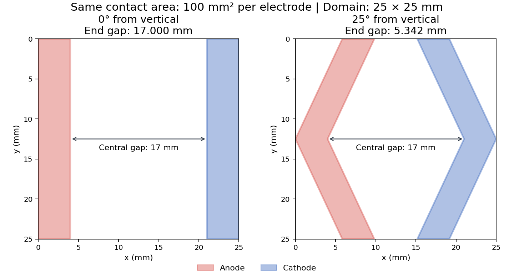

# 25 mm 전극 경사각 비교: 면적과 중앙 간격 고정

`run_electrode_parameter_study.py`의 별도 `inclined_strip_study_v1` 설정으로,
직선 전극과 위·아래 끝이 서로 가까워지는 좌우 대칭 꺾인 전극을 비교한다.
기존 직선 8조건, split 비교 및 148개 catalogue는 그대로 유지한다.
시간적분, 전기화학–열전달–분해반응식, onset 판정과 Vmin search는 기존
`ecsp_preflame` C++/CUDA evaluator를 사용한다.

## 형상 변수와 면적 보존

추진제 domain은 모든 경우 25×25 mm이며 전극 아래에도 추진제가 존재한다.
`inclination_deg`는 각 팔이 **수직 방향에서 기울어진 각도**다. 0°는 직선이다.
양극은 왼쪽, 음극은 오른쪽에 놓이고, 양극의 위·아래 끝은 오른쪽으로,
음극의 위·아래 끝은 왼쪽으로 이동한다. 중앙 높이의 위치는 고정된다.

| 입력 | 의미 |
|---|---|
| `anode_width_mm`, `cathode_width_mm` | 각 높이에서 측정한 수평 폭. 경사 팔에 수직인 폭이 아님 |
| `gap_mm` | 중앙 높이 y=12.5 mm에서 두 전극 가장자리 사이의 간격 |
| `inclination_deg` | 수직에서 측정한 경사각 θ; 0 이상 90° 미만 |
| `electrode_length_mm` | 위·아래 방향 투영 길이 25 mm. 경사진 중심선 길이가 아님 |
| `grid_size` | 셀 중심 격자 크기 N; 셀 간격은 h=25/N mm |

높이 y에서 한 전극의 수평 이동량과 두 전극의 간격은 다음과 같다.

\[
d(y)=|y-12.5|\tan\theta,\qquad
g(y)=g_{\mathrm{center}}-2|y-12.5|\tan\theta.
\]

따라서 위·아래 끝의 간격은
\(g_{\mathrm{end}}=g_{\mathrm{center}}-25\tan\theta\)이다.
각 전극의 수평 폭 w를 유지하므로 면적은 각도와 무관하게 **25w mm²**다.
직선 전극을 강체 회전하여 잘라내는 방식이 아니며, 면적을 맞추기 위한
mask fitting이나 사후 pixel 추가·삭제도 하지 않는다.

대신 경사 팔의 수직 폭은 \(w\cos\theta\), 꺾인 중심선의 전체 길이는
\(25/\cos\theta\)가 된다. 수평 폭·수직 폭·중심선 길이를 모두 고정하면서
이 면적 조건을 유지할 수는 없다. 실제 제작 치수는 이 구분을 따라야 한다.

한 설정의 모든 case는 같은 양극 폭·음극 폭·중앙 간격을 사용해야 하며,
각도만 다르게 지정한다. 0° 대조군은 정확히 하나 필요하다. 다른 치수를
비교하려면 설정 전체의 치수를 함께 바꾸고 새 output에서 실행한다.
case ID는 영문자로 시작하고 영문·숫자·`_`·`-`만 사용하며 기존 등록 ID를
재사용하지 않는다.

## 제공하는 예시

`config/electrode_inclination_study_25mm.yaml`의 폭 4 mm 및 중앙 간격 17 mm는
**첨부 스케치에서 측정한 값이 아닌 실행 예시**다. 실측 폭이 확정되면 수정한다.
이 예시는 4+17+4=25 mm이므로 0°에서 전극이 domain 좌우 경계에 닿는다.



| ID | 각도 | 중앙 간격 mm | 끝 간격 mm | 양극 면적 mm² | 음극 면적 mm² |
|---|---:|---:|---:|---:|---:|
| ANGLE_00 | 0° | 17 | 17.000 | 100 | 100 |
| ANGLE_05 | 5° | 17 | 14.813 | 100 | 100 |
| ANGLE_10 | 10° | 17 | 12.592 | 100 | 100 |
| ANGLE_15 | 15° | 17 | 10.301 | 100 | 100 |
| ANGLE_20 | 20° | 17 | 7.901 | 100 | 100 |
| ANGLE_25 | 25° | 17 | 5.342 | 100 | 100 |
| ANGLE_30 | 30° | 17 | 2.566 | 100 | 100 |

간격은 위 식으로 계산한 연속 형상의 값이다. solver에 전달되는 계단형 mask의
최소 간격은 별도로 기록한다. 기존 2 mm 중앙 간격을 사용하면 같은 큰 각도를
줄 수 없다. 예를 들어 최소 간격 1 mm를 유지하려면
\(\theta\le\arctan((2-1)/25)\approx2.29^\circ\)여야 한다.

양극·음극은 각각 등전위 금속 접촉으로 취급한다. 추진제 밖의 전압 인가 탭,
클램프 위치, 금속 자체의 저항과 기계적 고정은 계산 domain에 추가하지 않는다.
따라서 스케치의 탭 부착 높이 차이에 따른 효과를 이번 결과로 해석하지 않는다.

## 격자와 검증

기본 N=200이면 h=0.125 mm다. N은 100 이상인 50의 배수여야 하며 중앙의
전극 가장자리는 셀 경계와 정확히 일치해야 한다. 각 행의 전극 pixel 수는 고정하고
양극·음극을 같은 셀 수만큼 반대 방향으로 이동하여 각 극의 면적을 정확히 유지한다.
상하 대칭도 유지한다. 0°는 같은 치수의 직선 mask와 일치한다.

경사 경계는 직교 Boolean 격자에서 일반적으로 정확하게 표현되지 않는다.
연속 형상은 `geometry.svg`, 실제 계산 형상은 `mask.npz`에 저장된다.
`raster_max_boundary_error_mm`는 셀 행 전체에서 발생하는 수평 경계 오차의
상한이고, `raster_minimum_gap_mm`는 mask의 최소 간격이다. 각도 변화가 작아
여러 각도가 같은 mask를 만들면 생성을 거부한다. 격자를 세분화하거나 각도 차이를 늘린다.
N=200을 격자 독립성이 검증된 해상도로 간주하지 말고, 필요하면 N=400 등에서
새 output을 만들어 주요 성능 지표의 격자수렴성을 확인한다.

생성 시 면적, domain 이탈, 겹침, 연결성, 입력 치수와 각도를 검증한다.
기존 runtime의 제조 조건에 맞춰 **연속 형상의 끝 간격과 raster 최소 간격이
모두 1 mm 이상**, 양극·음극의 **경사 팔 수직 폭도 각각 1 mm 이상**이어야 한다.
따라서 수평 폭을 1 mm로 정하면 양의 경사각에서 수직 폭이 1 mm 미만이 되므로
각도 sweep을 만들 수 없다. 더 넓은 전극을 사용해야 한다.
생산 evaluator에서도 연속·raster 최소 간격을 다시 검사한다.
끝 간격이 양수라는 이유만으로 모든 각도가 허용되는 것은 아니다.
저장한 case 정의, metadata와
mask가 서로 다르면 audit가 실패하고, 각도·코드·설정 변경 후 기존 결과의 resume도
허용하지 않는다.

## 실행

### 0°부터 5° 간격으로 30°까지 실행

`generate-sweep`의 기본 각도는 **0, 5, 10, 15, 20, 25, 30°**다.
설정 파일의 명시적 `cases`도 같은 7개 조건이므로 `generate` 역시 이 목록을 생성한다.
`generate-sweep`은 설정 파일의 공통 폭·중앙 간격·격자를 가져오고, `cases`의
각도 목록을 요청한 목록으로 대체한다. 사용자 목록에 0°가 없으면 대조군을 자동 추가한다.

```bash
RUN="$PWD/runs/straight25_angles_0_to_30"
python python/run_electrode_parameter_study.py generate-sweep \
  --study-config config/electrode_inclination_study_25mm.yaml \
  --angles 0 5 10 15 20 25 30 \
  --out "$RUN"
python python/run_electrode_parameter_study.py audit --out "$RUN"
python python/run_electrode_parameter_study.py evaluate \
  --out "$RUN" --device cuda --batch-size 7
```

`--angles`를 생략해도 위 0~30° 목록을 사용한다. 일부 각도만 지정하거나 소수
각도를 지정할 수도 있다. 형상·격자 제약 때문에 불가능한 각도는 제외 이유와 함께
`angle_feasibility.csv` 및 `.json`에 남긴다. 요청 원본은 `sweep_request.json`에
저장한다. 제외된 각도는 solver와 실험 순서표에 들어가지 않는다. 이는 무점화나
수치해석 실패가 아니라 **형상 생성 불가**를 뜻한다. 0° 외에 생성 가능한 각도가
하나도 없으면 오류로 종료한다. 직접 `generate`를 사용하는 기존 방식은 잘못된
case 하나만 있어도 전체 요청을 거부한다.

현재 예시 폭 4 mm·중앙 간격 17 mm·높이 25 mm에서는 최대 각도가 약 32.62°다.
따라서 기본 목록의 **0, 5, 10, 15, 20, 25, 30°의 7개 모두**를 생성한다.
별도 요청에 불가능한 각도가 포함되면 해당 각도만 제외 이유와 함께 보고한다.
각도를 자동 축소하거나 전극 폭·면적·중앙 간격을 바꾸지 않는다.

실험 집계 시에는 생성한 실제 case 목록을 사용해야 한다.

```bash
python python/run_electrode_parameter_study.py summarize-experiments \
  --study-config "$RUN/study.json" \
  --input "$RUN/experiment_measurements.csv" \
  --out "$RUN/experiment_summary.csv"
```

### 설정 파일의 명시적 case 목록 사용

저장소 루트의 기존 Python 실행 환경에서 다음을 실행한다.

```bash
export PYTHONPATH="$PWD/python${PYTHONPATH:+:$PYTHONPATH}"
RUN="$PWD/runs/straight25_inclination"

python python/run_electrode_parameter_study.py generate \
  --study-config config/electrode_inclination_study_25mm.yaml \
  --out "$RUN"

python python/run_electrode_parameter_study.py audit --out "$RUN"

python python/run_electrode_parameter_study.py evaluate \
  --out "$RUN" --device cuda --batch-size 7
```

CPU에서는 마지막 명령의 `--device cuda`를 `--device cpu`로 바꾼다.
MPS는 사용하지 않는다. 기존 output은 덮어쓰지 않으므로 설정을 바꾼 후에는
새 경로를 지정한다. 같은 입력으로 중단한 계산을 이어갈 때는 다음과 같이 실행한다.

```bash
python python/run_electrode_parameter_study.py evaluate \
  --out "$RUN" --device cuda --batch-size 7 --resume
```

### 최소 점화 전압 탐색 생략

고정 기준 전압(기본 260 V)에서 각도별 성능만 비교하려면 `evaluate`에
`--skip-vmin`을 추가한다. 기준 전압의 시간적분, 응축상 onset 판정, 공통 평가
시각까지의 continuation, 전류·온도·에너지·미분해 지표와 물리장 저장은 그대로다.

```bash
python python/run_electrode_parameter_study.py evaluate \
  --out "$RUN" --device cpu --batch-size 1 --skip-vmin
```

최소 전압 값과 유효성 칸은 공란이고, `minimumIgnitionVoltageSearchStatus`는
`not_requested_reference_voltage_only`다. `referenceAppliedVoltage_V`에 실제
기준 전압을 저장한다. 미실행 전압 탐색에 실패 penalty나 가짜 전압을 넣지 않는다.
탐색을 켜고 실행했던 폴더와는 설정이 다르므로 새 실행 폴더를 생성해야 한다.
재개할 때에는 원래 명령의 `--skip-vmin`도 유지하고 `--resume`을 추가한다.

기본 전압 탐색은 기준 전압에서 onset이 없으면 추가 PDE를 실행하지 않는다.
onset이 있으면 하한 20 V, 최대 6회의 이분 탐색(260−20 V 폭을 5 V 이하로),
필요한 최종 상한 재검증까지 기준 계산을 포함해 최대 9회 수행한다.
탐색의 성공 trial은 onset에서 조기 종료하므로 횟수와 실제 시간 비율은 다르다.
실측 시간은 `adapter/cpp_cuda_batch_waves.jsonl`의 `role`과 `elapsed_s`로
기준 계산(`reference`)과 추가 전압 탐색을 구분해 확인한다.

실제 실험으로 보정한 physics 입력을 사용할 경우 `evaluate`에
`--physics-config config/YOUR_EXISTING_CALIBRATED_CONFIG.yaml`을 추가한다.
기본 입력은 기존 `config/preflame_electrochemical_thermal_decomposition_a100_cpu8.yaml`이다.
`generate`와 `audit`는 PDE를 실행하지 않는다. 실행 명령과 예시 형상 제공 자체는
생산 PDE 계산 완료 또는 점화 성능 우위를 의미하지 않는다.

## 결과와 실험 기록

`library/<ID>/`에 `geometry.svg`, `mask.npz`, `metadata.json`을 저장한다.
각도의 정의, 중앙·끝 간격, 수직 폭, 중심선 길이, 목표·실제 면적 및 raster 오차는
metadata에 남는다. 해석 후 `parameter_study_summary.csv`와
`inclination_summary.csv`에서 각도별 raw 성능 지표와 유효성 flag를 비교한다.
수치적으로 무효인 결과의 성능 값은 공란으로 두고, 원본 solver 값은
`cases/<ID>/result.json`에 보존한다. 응축상 onset 시간은 visible-flame delay와
동일한 관측량으로 간주하지 않는다.

기본 예시는 7조건×5회=35행의 실험 기록 template과 무작위 block 순서표를 생성한다.
이는 실제 실험 계획이며 35회 시뮬레이션이나 생성된 실험결과가 아니다.
측정값을 별도 `experiment_measurements.csv`에 기록한 뒤 다음과 같이 집계한다.

```bash
python python/run_electrode_parameter_study.py summarize-experiments \
  --study-config config/electrode_inclination_study_25mm.yaml \
  --input "$RUN/experiment_measurements.csv" \
  --out "$RUN/experiment_summary.csv"
```

`valid`, 제외 사유, 관측창, 무점화의 처리 및 성공한 시험에 한정한 지연시간
통계는 [기존 직선 study 문서](ELECTRODE_PARAMETER_STUDY_25MM_KR.md)의 규칙을 따른다.

## 구현 검증 기록

```bash
python -m pytest -q tests/test_electrode_parameter_study.py \
  tests/test_electrode_split_study.py \
  tests/test_electrode_inclination_geometry.py \
  tests/test_electrode_inclination_study.py
```

최초 0°/10°/20°/25° 비교 기능 추가 시 위 테스트 **118개 통과**. 기존 직선·분할 study 회귀검사, 0°에서 기존 8개 직선
mask와의 정확한 일치, 면적·대칭·연결성·최소 간격, 손상 입력 거부,
실행 연결·재개·CSV 집계를 확인했다. 실행 연결 테스트의 fake evaluator는
물리 정확도를 검증하지 않는다. CLI의 `generate`와 `audit`도 실행했다.

별도로 실제 C++ standalone CPU 해석기에서 0°/25° 두 경우를 N=100,
260 V, dt=0.00025 s의 **1 step**으로 실행했다. 두 경우 모두 전기 선형 해와
비선형 Robin 반복이 수렴했고 최종 물리장은 유한했다. 이 검사는 형상 전달 및
짧은 시간적분의 실행 확인이다. 전체 2초 계산, Vmin 검색, CUDA/A100 실행,
격자수렴성 및 실험적 점화 성능 비교는 수행하지 않았다.

이전 5~60° 기본 sweep을 추가했을 때 위 네 테스트와 `tests/test_electrode_inclination_sweep.py`를
함께 실행하여 **149개 통과**를 확인했다. 기본 sweep의 CLI 생성·audit에서도
7개 허용/6개 제외가 확인됐다. 이는 이전 기본값의 검증 기록이며, 현재 기본 목록은
0~30°의 7개 조건이다. 해당 sweep 추가에서 새 생산 PDE 계산은 실행하지 않았다.

현재 0~30° 기본값 및 가로 12 mm·세로 25 mm 계산 검증을 반영한 뒤 관련
테스트 **150개 통과**를 확인했다. 기본 `generate-sweep`과 `audit`에서
**7개 허용·0개 제외**를 확인했다. 이번 수정에서 새 생산 PDE 계산은 실행하지 않았다.

## 가로 12 mm·세로 25 mm로 바꿀 때의 기하학적 한계

여기서는 **가로 12 mm·세로 25 mm**를 뜻하며 각도는 수직 기준이다.
이 domain의 실제 직사각형 격자와 폭 2 mm·4 mm 선택은
[12×25 mm 비교 안내](ELECTRODE_RECTANGULAR_STUDY_12X25MM_KR.md)를 따른다.
아래 값과 `electrode_inclination_sweep.inclination_limits()`는 연속기하 계산이며,
실제 생성 시에는 raster의 최소 간격도 별도로 검사한다.

양극·음극의 수평 폭을 각 4 mm로 유지하고 중앙 높이에서 좌우 domain 경계에
배치하면, 중앙 간격은 **12−4−4=4 mm**다. 기존 17 mm 간격은 가로 12 mm
안에 들어가지 않는다. 세로 길이는 여전히 25 mm이므로 각 극의 접촉면적은
**25×4=100 mm²**로 유지된다.

세로 길이 H, 중앙 간격 g, 최소 끝 간격 g_min에 대해

\[
g_{\rm end}=g-H\tan\theta,\qquad
\theta_{\rm gap}=\arctan\frac{g-g_{\min}}{H}.
\]

여기에 각 극의 수직 폭 조건 \(w\cos\theta\ge1\,\mathrm{mm}\)도 적용한다.
최소 끝 간격 1 mm를 유지할 때 가로 12 mm·세로 25 mm의 최대각은

\[
\theta_{\max}=\arctan\frac{4-1}{25}
=6.842773\ldots^\circ.
\]

이 각도에서는 폭 조건보다 끝 간격 조건이 먼저 제한한다.

| Domain 가로×세로 | 중앙 간격 | 연속기하 최대각 | 5° 간격에서 최대각 | 극당 접촉면적 |
|---|---:|---:|---:|---:|
| 25×25 mm | 17 mm | 32.619° | 30° | 100 mm² |
| 12×25 mm | 4 mm | 6.843° | 5° | 100 mm² |

가로 12 mm·세로 25 mm에서의 끝 간격은 다음과 같다.

| 각도 | 끝 간격 | 최소 간격 1 mm 충족 |
|---|---:|---|
| 0° | 4.000 mm | 충족 |
| 5° | 1.813 mm | 충족 |
| 10° | −0.408 mm | 불충족: 전극 겹침 |

따라서 이 치수에서 5° 간격으로 선택하면 **0°와 5°만 가능**하다.
최소 간격 1 mm 조건을 무시하더라도 접촉이 시작되는 각도는
\(\arctan(4/25)=9.090277\ldots^\circ\)이므로, 겹치지 않으려면 그보다 작아야 한다.
폭이나 좌우 여백을 바꾸면 중앙 간격도 바뀌며 최대각을 다시 계산해야 한다.
